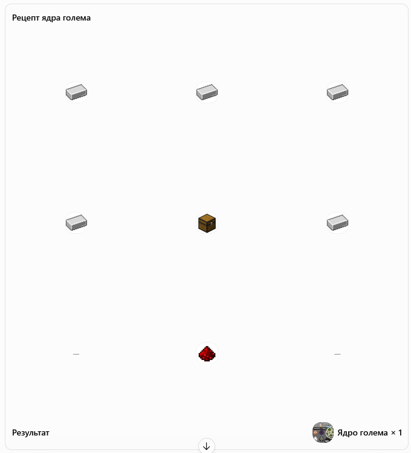

# Сборка модов от ЗПР/24 

Документация [Fabric Documentation page](https://docs.fabricmc.net/develop/getting-started/creating-a-project#setting-up) 

## Версии

- Minecraft: 26.3
- Fabric Loader: 0.19.5
- Fabric Loom: 1.17-SNAPSHOT
- Fabric API: 0.162.0+26.3
- Gradle: 9.7.1
- Java : 25 (JetBrains Runtime 25.0.4)

***

## Ник и скин у каждого свой

**1. Ник.** Ник определяет UUID игрока, поэтому у каждого он должен быть свой. Не правь `build.gradle` - у каждого в личном файле
`~/.gradle/gradle.properties` (Windows: `C:\Users\<ты>\.gradle\gradle.properties`) добавь строку:

```
mc_username=Sanya
```

**2. Скин.** Положи свой PNG (64x64, подходит и старый 64x32) в

`<папка запуска игры>/config/magicwand/player_skin.png` (при запуске из IDEA это `run/config/magicwand/player_skin.png`).

Скин загрузится на сервер при входе в мир, а если заменить файл прямо во время игры - обновится сам в течение секунды.
Сервер запоминает скины (`config/magicwand/server_skins/` у того, кто держит сервер) и показывает их всем, в том числе зашедшим позже.

> Файл `run/` **не должен** лежать в git - иначе у всех будет один и тот же скин. Если он уже закоммичен: `git rm -r --cached run`

**3. Руки (Стив / Алекс).** По умолчанию определяются автоматически по самому скину. Принудительно:

- `/skin model slim` - тонкие руки (Алекс)
- `/skin model wide` - обычные руки (Стив)
- `/skin model auto` - снова по файлу
- `/skin info` - что сохранено, `/skin reset` - убрать свой скин

***

### Фонарик

Добавляет в игру фонарик. Нажми ПКМ, чтобы переключить его (вкл \ выкл)

Выдать фонарик в чате 🔦

`/give @s magicwand:flashlight_off 1`

Предмет в любой руке освещает всё вокруг игрока (как в OptiFine).
Работает на сервере, поэтому свет видят все игроки и ставить сторонние моды (LambDynamicLights) **не нужно**.

- `/dynlight on` / `/dynlight off` - включить / выключить
- Список предметов и яркость: `config/magicwand/dynamic_light.txt` (после правки `/dynlight reload`)

Технически: сервер двигает за игроком невидимый блок `minecraft:light`. При выходе игрока и остановке сервера блоки убираются,
а после аварийного закрытия игры убираются при следующем запуске.

## Версии

- Minecraft: 26.3
- Fabric Loader: 0.19.5
- Fabric Loom: 1.17-SNAPSHOT
- Fabric API: 0.162.0+26.3
- Gradle: 9.7.1
- Java : 25 (JetBrains Runtime 25.0.4)


### Магическая палочка

- Создаёт огонь при использовании 🔥 

Игрок нажимает ПКМ палочкой и палочка выпускает огненный снаряд вперёд.

- Shift + ПКМ призывает чёрного котика 🐈‍⬛

Выдать палочку в чате 🪄

`/give @s magicwand:magic_wand 1`

***

### Черная дыра (Ростислав)

`/voidcraft create` - создаёт чёрную дыру перед игроком

`/give @s voidcraft:void_core` - получить Ядро Пустоты 

1. Создание чёрной дыры специальным предметом — Ядро Пустоты
2. Создание чёрной дыры командой /voidcraft create
3. Притяжение мобов, игроков, выпавших предметов и блоков
4. Постепенное поглощение объектов (радиус 8 блоков)
5. Счётчик поглощённых объектов
6. Взрыв после поглощения 20 объектов (радиус взрыва 4 блока)

- Каждый тик чёрная дыра ищет объекты в радиусе 8 блоков.
- Объекты получают дополнительную скорость в направлении центра.
- Игроки притягиваются, но не поглощаются.
- Мобы и выпавшие предметы поглощаются при приближении.
- Раз в секунду разрушаются блоки в центральной области.
- После 20 поглощений происходит взрыв.

***

### Единорог

🦄 белый единорог цветной гривой и хвостом. 
Он будет вести себя как лошадь: ходить по миру, приручаться, надевать седло и перевозить игрока.
После приручения можно надеть седло и при нажатии клавиши `G` единорог должен ускориться и светиться.
`/summon magicwand:unicorn`

***

### Снайперка (Коля)

Можно скрафтить снайперку:
 - 3 медных блока
 - 1 медный слиток
 - 1 рычаг
 - 1 бинокль

Скрафтить пули:
 - 2 медных слитка
 
винтовка: `/give @s magicwand:sniper_rifle 1`

пули: `/give @s magicwand:sniper_ammo 10`

### Кнопка телепортации (Коля)

Можно скрафтить кнопку:
``` 
    Пусто           Шерсть(любая)  Пусто
    Железо(слиток)  Жемчуг Края    Железо
    Пусто              Пусто       Пусто
```

`/give @s magicwand:teleport_item 1`

1. Взять кнопку в руку
2. shift + ПКМ - установить кнопку (место телепортации)
3. ПКМ - переместиться в точку телепортации

***

### Голем-кладовщик (Виталий)

Голем для складывания вещей из инвентаря игрока по сундукам по категориям:

Реализованные категории:
- Дерево
- Еда
- Руды и минералы
- Строительные материалы
- Броня
- Оружие
- Инструменты
- Предметы из Нижнего мира
- Зелья
- Разное

#### Инструмент назначения категорий
Сначала надо расставить сундуки и назначить каждому необходимую категорию. 

Для этого нужен `инструмент назначения категорий`

`/give @s golem:golem_configurator`

Чтобы скрафтить:
``` 
    Железо  Редстоун  Железо
    Пусто    Палка    Пусто
    Пусто    Палка    Пусто
```

Механика: берёшь инструмент и нажимаешь ПКМ по сундуку.

Каждое нажатие переключает категорию по кругу:

Дерево → Еда → Руды → Строительство → Броня → Оружие → Инструменты → Предметы из Нижнего мира → Зелья → Разное → Дерево

#### Как призвать голема: скрафтить ядро голема


Нажатие ПКП создаёт голема.

`/summon magicwand:storage_golem`

ПКМ по голему открывает инвентарь голема (на 27 слотов) и можно переносить ненужные предметы из своего инвентаря для дальнейшей сортировки.

Чтобы голем разложил вещи по помеченным заранее сундукам, нажать кнопку "Сортировать".

#### TODO:
- добавить анимацию хождения для голема
- добавить сохранение вещей в инвентаре голема между перезапусками


### Медная рука (Коля)

Для переноса блоков и сущностей (Коля)

Можно скрафтить кнопку:
``` 
    Пусто           медный слиток   Пусто
    медный слиток     Жемчуг Края   медный слиток
    Пусто           медный слиток   Пусто
```

`/give @s magicwand:grabber 1`

1. Взять руку в руку
2. shift + ПКМ - взять блок/сущность
3. ПКМ - поставить блок/сущность